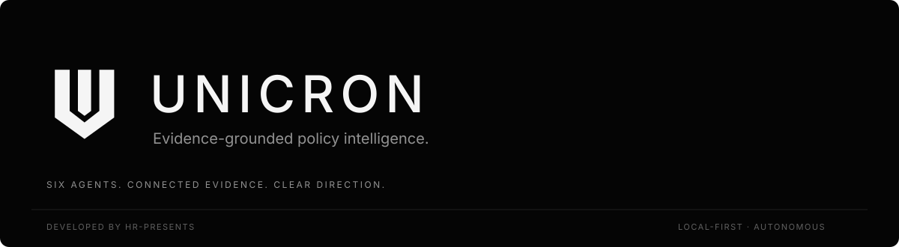
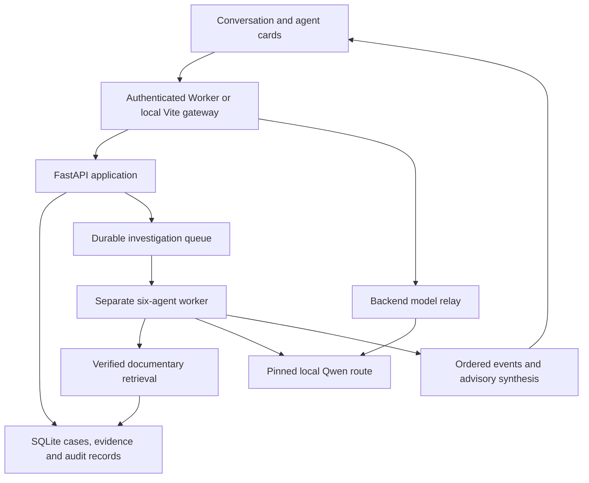

<div align="center">



**Unified Network for Intelligence, Compliance, Research, Oversight and Navigation**

**AUTONOMOUS · EVIDENCE-GROUNDED · LOCAL-FIRST · SIX SPECIALIZED AGENTS**

[](https://github.com/HR-Presents/Unicron/actions/workflows/ci.yml)
[](backend/requirements.txt)
[](frontend/package.json)
[](frontend/package.json)
[](https://github.com/HR-Presents)

[Overview](#overview) · [Agents](#the-six-agents) · [Architecture](#architecture) · [Installation](#installation) · [Knowledge base](#knowledge-base-and-evidence) · [API](#api-and-integrations) · [Verification](#verification) · [Hackathon alignment](#hackathon-alignment) · [Troubleshooting](#troubleshooting)

**DEVELOPED AND OWNED BY HR-PRESENTS**

</div>

## Overview

UNICRON is a conversational AI intelligence workspace for investigating domain-specific cases, connecting documentary evidence to policy questions, and examining relevant global practices. Describe a case, inspect six independent agent responses, read a concise synthesis, open the supporting source passages, and ask follow-up questions.

The interface is deliberately small: investigation history on the left, conversation in the centre, and six expandable agent cards in the same scrollable reading area. Agent status comes from persisted execution events. Matte black and porcelain themes are included. There are no simulated progress bars, decorative dashboards or mandatory approval screens in normal investigations.

UNICRON is an **advisory analysis system**. Completing an analysis does not establish legal applicability, certify compliance, authenticate a document, or execute a government decision. Missing sources, uncertain assumptions and unsupported comparisons remain explicit.

### What works

| Capability | Actual implementation |
| --- | --- |
| Natural conversation | Model-backed chat and automatic routing between general conversation and substantive investigations |
| Six-agent investigations | Durable SQLite queue, separate worker, ordered checkpoints and persisted results |
| Agent responses | Independent recorded assessments, visible in the conversation and expandable agent cards; selected-agent follow-ups |
| Documentary evidence | Text/PDF extraction, chunking, ranked retrieval, source provenance, SHA-256 records and citation validation |
| Shared regulatory archive | Read-only retrieval of eligible verified passages across cases, independent of the code checkout |
| Policy and global context | Extractive policy evidence, cross-jurisdiction evidence matrices, assessed comparison drafts and legal-scope checks |
| Readable answers | Findings, specific next steps, uncertainties and source references instead of internal JSON fields |
| Source inspection | Exact citation-to-passage lookup with title, jurisdiction, excerpt and official source link |
| Research operations | Discovery, isolated bounded HTTPS retrieval and authenticated import; imported material starts unverified |
| Scenario exercises | Persisted, progressively released scenario events and recorded assessments through the backend API |
| Collaborative knowledge | Versioned community contributions and moderation; community text is contextual, not official evidence |
| Model management | Local Qwen-compatible transport, pinned routes, durable routing, runtime/preflight and activation helpers |
| Knowledge export | Verified-passages JSONL plus integrity manifest; no automatic external publication |

### What is not claimed

The current retrieval engine is **ranked lexical retrieval over SQLite passages**, not a deployed distributed vector database. The repository does not bundle a national PDF corpus, model weights, model fine-tuning, ITU Sandbox credentials, a cloud GPU, a Windows installer or an ITU conformity certificate. The hosted frontend needs a separately running, authenticated backend and model. See [requirements and remaining integration work](docs/REQUIREMENTS.md).

## The six agents

| Agent | Responsibility | Recorded response |
| --- | --- | --- |
| **Intake & Triage** | Classify the case and identify immediate information needs | Rationale, provisional priority, missing evidence and proposed actions |
| **Evidence Analyst** | Analyze eligible documentary passages | Source-linked findings, contradictions, evidence gaps and checks |
| **Policy Advisor** | Identify relevant policy passages and applicability limits | Extractive evidence and policy context without invented legal approval |
| **Global Benchmark Agent** | Compare relevant evidence across jurisdictions | Evidence matrix, model-assessed comparisons and unsupported-claim flags |
| **Scenario Evaluator** | Examine a hypothetical operational scenario | Risks, possible safeguards and explicit assumptions |
| **Review & Synthesis** | Answer the case using the recorded agent work | Readable findings, next steps, uncertainties and evidence references |

A completed advisory stage is displayed as **Completed**, even when its conclusions have limitations. A failed stage or one missing required sources is not silently promoted to completed. General greetings and product questions do not pretend to execute six agents.

Open **Agents** and select a card to inspect its response. When a case is selected, the composer can direct a follow-up to that agent using its actual evidence role. Close the selected agent response, or use × beside the composer’s agent label, for synthesis-level follow-ups.

## Architecture



The frontend is React 19/Vite. The API is FastAPI/Pydantic. SQLite stores cases, passages, provenance, investigations, execution events, scenarios and audit records. The gateway keeps API and model credentials outside browser JavaScript. Model inference uses an OpenAI-compatible protocol against the configured **local Qwen service**; this is not an OpenAI API dependency.

### Repository map

| Path | Purpose |
| --- | --- |
| `frontend/src/main.jsx` | Conversation state, navigation, composer and investigation rendering |
| `frontend/src/AgentActivity.jsx` | Six explained agent cards and selected-agent responses |
| `frontend/src/ReportResponse.jsx` | Readable reports and expandable documentary references |
| `frontend/src/report-model.mjs` | Typed presentation of findings, recommendations and evidence limitations |
| `frontend/product.mjs` | Canonical UNICRON/HR-Presents identity and agent names |
| `frontend/server/gateway.mjs` | Authenticated API proxy, routing, chat and citation-checked follow-ups |
| `backend/app/investigation.py` | Six-stage workflow, source checks, persistence and synthesis |
| `backend/app/evidence.py` | Ingestion, retrieval, analysis and exact verified passage lookup |
| `backend/app/research_*.py` | Research discovery, URL/network protections and isolated import |
| `backend/app/model_orchestrator/` | Local model routing, pinning, lifecycle and preflight helpers |
| `backend/app/job_queue.py` | Durable queue, worker heartbeat and recovery APIs |
| `backend/app/scenario_sessions.py` | Progressively released hypothetical exercises |
| `backend/app/standards_registry.py` | Case-specific framework/requirement traceability |
| `scripts/` | Restart, connection checks, packaging and knowledge export |
| `tests/`, `backend/tests/`, `frontend/test/` | Regression coverage; no live model required for the automated suite |
| `docs/REQUIREMENTS.md` | ITU requirements mapping and clearly identified gaps |

## Installation

### 1. Prerequisites

- Linux or WSL2 for the full supported workflow. The isolated research child uses POSIX resource limits. Native Windows operation has not been validated.
- Python **3.12** for the documented/tested setup.
- Node.js **22.12+** and npm, compatible with the installed Vite version.
- Git and enough disk space for your chosen model and source documents.
- A separately running local model service. GPU/VRAM and driver requirements depend on the selected runtime, model, quantization and context length; no universal hardware requirement or performance guarantee is implied.

### 2. Clone the source-of-truth branch

```bash
git clone --branch development https://github.com/HR-Presents/Unicron.git
cd Unicron
```

The source-of-truth branch is **`development`**. Older design branches are historical and are not the current interface.

### 3. Install application dependencies

```bash
python3 -m venv .venv
.venv/bin/python -m pip install --upgrade pip
.venv/bin/python -m pip install -r backend/requirements.txt
npm ci --prefix frontend
```

To run the Python tests, install the development requirements as well:

```bash
.venv/bin/python -m pip install -r requirements-dev.txt
```

### 4. Start or reuse Qwen

If you already have a working Qwen server, keep it running and use its existing endpoint and served model name. UNICRON does not automatically download or start a model when `start.sh` runs.

For a new compatible Linux/GPU environment, install vLLM separately following its [official GPU installation guide](https://docs.vllm.ai/en/latest/getting_started/installation/gpu/). Keep model-runtime dependencies separate from the application environment. The repository's launch helper builds the following form of command:

```bash
vllm serve /absolute/path/to/a/compatible/model-snapshot \
  --served-model-name unicron-qwen \
  --host 127.0.0.1 \
  --port 42516 \
  --dtype auto \
  --max-model-len 4096 \
  --gpu-memory-utilization 0.8 \
  --max-num-seqs 2
```

Replace the snapshot path with a real compatible model. This command is not a claim that every model fits your GPU. Model files, model licenses and runtime installation are external to this repository. A compatible llama.cpp server can also be used if it implements the required chat-completions interface and the requested non-thinking/structured-output behavior; verify that runtime's model name and API responses.

Check the actual served model ID:

```bash
curl http://127.0.0.1:42516/v1/models
```

### 5. Configure the application

In the terminal used to launch UNICRON:

```bash
export CIVITAS_DB_PATH="$PWD/backend/data/unicron_workspace.sqlite3"
export CIVITAS_LLM_BASE_URL="http://127.0.0.1:42516/v1"
export CIVITAS_LLM_MODEL="unicron-qwen"
export UNICRON_MODEL_VIA_BACKEND="1"
export CIVITAS_API_KEY="$(python3 -c 'import secrets; print(secrets.token_urlsafe(32))')"
```

For an existing installation, preserve its current `CIVITAS_DB_PATH` and API key. Do not generate a replacement key each time if a hosted gateway already uses the existing one. Set `CIVITAS_LLM_API_KEY` separately only when the local inference server requires bearer authentication.

The current model router accepts numeric-loopback HTTP endpoints in the form `http://127.0.0.1:PORT/v1`. A public model endpoint is not required: the frontend can relay inference through the authenticated API.

Environment examples are documented in [backend/.env.example](backend/.env.example) and [frontend/.env.example](frontend/.env.example). Backend example files are documentation, not automatically loaded shell configuration. The Vite gateway can read its ignored `.env.local`; do not use `VITE_` prefixes for secrets.

### 6. Connect the shared documentary archive

If you already have an eligible source archive:

```bash
export CIVITAS_EVIDENCE_ARCHIVE_PATH="/absolute/path/to/existing/civitas.sqlite3"
```

Without that setting, the archive resolves to `civitas.sqlite3` beside the configured workspace database. It is opened read-only. A new clone has no source corpus; the UI must report missing documentary evidence until material has been ingested and its provenance established. No document becomes verified merely because it was uploaded or found online.

### 7. Launch the workspace

```bash
./start.sh
```

The launcher starts the API, separate investigation worker and frontend, then prints their local URLs. Keep that terminal open. Qwen must already be running.

Ports are selected automatically by default. To request stable ports, export unused values before launching:

```bash
export UNICRON_BACKEND_PORT=42515
export UNICRON_FRONTEND_PORT=5173
./start.sh
```

The launcher rejects invalid, identical or occupied ports. Open the printed frontend URL. Use **New investigation** to describe a case; open **Agents** to inspect individual responses. Navigation collapses into a drawer on smaller screens; agent cards remain in the main scrollable area.

### 8. Verify the connection

In a second terminal, use the API address printed by the launcher:

```bash
export UNICRON_API_URL="http://127.0.0.1:42515"
.venv/bin/python scripts/check-connections.py
```

Change `42515` if your API uses another port. Supply the same API/model authentication environment where required. This check verifies reachability and model advertisement; it does not execute inference or prove that an investigation succeeds.

A real verification run must queue a case, observe six recorded stages, retrieve the persisted synthesis and ask a source-linked follow-up. Run `python3 scripts/verify-live.py --base http://127.0.0.1:YOUR_FRONTEND_PORT` using the origin printed by the launcher. This makes real model requests and creates a retained verification case. To reuse the latest job from an existing case, add `--case-id CIV-...`. The command fails if a stage is missing, human approval blocks normal advisory output, persisted events are absent, or a documentary follow-up citation cannot be resolved. A response containing only agent-generated references does not pass the evidence check. Network/model failures remain failures; automated tests use controlled fixtures, not live Qwen.

## Everyday workflow

1. Enter a substantive case in the composer. Ordinary conversation remains conversation; case requests create an investigation.
2. The API persists the case and queues real work. The separate worker records each stage in order.
3. Read the synthesis in the main conversation. Empty fields and internal owner/status objects are not dumped into the answer.
4. Expand **Agent responses**, or open **Agents** and select a card, to inspect its independent recorded assessment.
5. Open source references to inspect exact documentary passages. Citation IDs identify passages; they do not independently prove legal applicability or semantic entailment.
6. Ask a focused follow-up. Selecting an agent directs the question to its corresponding role; the overview uses synthesis context.
7. If a job fails, inspect its retained activity and use the recovery action when available. Do not repeatedly create duplicate cases to retry the same job.

Conversation turns created in the browser are stored in that browser's local storage. Cases, runs, events, evidence and audit records are stored in SQLite. Browser chat history is not currently a synchronized multi-device conversation service. Responses use JSON requests; streaming is not advertised by the current gateway.

## Knowledge base and evidence

### Ingesting documents

- `POST /api/cases/{case_id}/evidence` accepts multipart evidence uploads. Direct uploads are bounded to **2 MiB** and **300 chunks** by the current implementation.
- Authenticated research import at `POST /api/cases/{case_id}/research/import` uses isolated, bounded HTTPS retrieval. Research PDF extraction is capped at **200 pages**, **600,000 extracted characters** and **1,000 chunks**, in addition to network/file limits enforced by the retrieval layer.
- Source metadata records the authority, jurisdiction, title, official URL, source type and dates. Uploaded/imported material starts unverified.
- Optional authenticated provenance verification is distinct from approving an investigation. The workspace does not insert an approval screen into normal advisory analysis.
- `POST /api/cases/{case_id}/research/discover` returns research candidates. It can use configured Brave Search or a keyless RSS fallback. Discovery does not establish source authenticity or applicability.
- Community contributions remain moderated context and are not counted as official policy evidence merely because they have been accepted into the community collection.

Use the running API's `/docs` and `/openapi.json` as the request/response contract. Source provenance, source eligibility, citation existence, claim support, jurisdictional applicability and compliance are separate concepts.

### Exporting knowledge for an ingestion pipeline

```bash
.venv/bin/python scripts/export-knowledge.py \
  --database /absolute/path/to/civitas.sqlite3 \
  --output /absolute/path/to/new-output/unicron-knowledge.jsonl
```

The exporter opens the source database read-only and writes eligible verified passages with citation IDs, provenance and passage hashes, plus a manifest. It refuses to overwrite an existing export. Source-document licensing still applies. This prepares local JSONL data; it does not create embeddings, deploy a distributed vector store or upload to the ITU Lab.

### Preserving existing data during updates

Keep worktree code, workspace data and model state separate. `CIVITAS_DB_PATH` must continue pointing to your existing database. `CIVITAS_EVIDENCE_ARCHIVE_PATH` can preserve access to the original regulatory archive from any checkout. Never copy a development database over your working database to make an empty installation appear populated.

For an already running integrated checkout with no active jobs:

```bash
git fetch origin
git merge --ff-only origin/development
python3 scripts/restart-local.py
```

The restart helper reads the current local API's environment without printing its credentials, checks the existing database for queued/running investigations, stops matching API/worker/frontend processes, and restarts them. It recognizes both `app.worker` and `job_queue` entry points. It leaves Qwen running. It refuses ambiguous or active-service states. The main launch command remains `./start.sh` for a fresh setup.

## Configuration reference

| Variable | Used by | Meaning |
| --- | --- | --- |
| `CIVITAS_DB_PATH` | API and worker | Existing workspace SQLite database; unset default is `backend/data/civitas.sqlite3` |
| `CIVITAS_EVIDENCE_ARCHIVE_PATH` | Evidence retrieval | Optional shared archive; default is `civitas.sqlite3` beside the workspace database |
| `CIVITAS_API_KEY` | API | Bearer authentication; use it before exposing the API beyond loopback |
| `CIVITAS_LLM_BASE_URL` | Model router | Local `http://127.0.0.1:PORT/v1` inference endpoint |
| `CIVITAS_LLM_MODEL` | Model router | Served model alias; default router alias is `unicron-qwen` |
| `CIVITAS_LLM_API_KEY` | Model client | Optional model-service bearer token |
| `CIVITAS_MODEL_ROUTING_PERSISTENT` | Model router | `1` enables persistent routing; default `0` |
| `CIVITAS_MODEL_ROUTING_DB` | Model router | Optional routing-state database; preserve it when moving an existing persistent deployment |
| `CIVITAS_MODEL_ADMIN_TOKEN` | Model management | Optional protected model activation administration |
| `CIVITAS_REVIEWER_API_KEY` | Legacy provenance/moderation APIs | Optional source-verification/administrative credential; not a normal investigation approval gate |
| `BRAVE_SEARCH_API_KEY` | Research discovery | Optional search-provider credential; otherwise the implemented fallback is used |
| `UNICRON_API_URL` | Gateway/diagnostics | API origin without the trailing `/api` |
| `UNICRON_API_TOKEN` | Gateway | Same value as the backend API key |
| `UNICRON_MODEL_VIA_BACKEND` | Gateway | `1` relays routing/chat/follow-up inference through the backend's current local model route |
| `UNICRON_MODEL_URL`, `UNICRON_MODEL_NAME`, `UNICRON_MODEL_TOKEN` | Gateway | Optional direct server-side model connection when relay mode is disabled |
| `UNICRON_REVIEWER_TOKEN`, `UNICRON_REVIEWER_USER_ID` | Gateway | Optional restricted legacy provenance/standards actions |
| `UNICRON_BACKEND_PORT`, `UNICRON_FRONTEND_PORT` | Launcher | Optional stable, unused local ports |

## API and integrations

| Operation | Method | Endpoint |
| --- | --- | --- |
| Basic API health | GET | `/api/health` |
| Cases | GET / POST | `/api/cases` |
| Queue investigation | POST | `/api/cases/{case_id}/investigate/async` |
| Jobs | GET | `/api/cases/{case_id}/jobs` |
| Recorded executions | GET | `/api/cases/{case_id}/executions` |
| Ordered agent events | GET | `/api/cases/{case_id}/executions/{run_id}/events` |
| Saved investigation reports | GET | `/api/cases/{case_id}/investigations` |
| Evidence upload/list | POST / GET | `/api/cases/{case_id}/evidence` |
| Evidence search | GET | `/api/cases/{case_id}/evidence/search` |
| Exact verified passage | GET | `/api/evidence/verified/passages/{document_id}/{position}` |
| Discovery / import | POST | `/api/cases/{case_id}/research/discover` and `/research/import` |
| Community contributions | POST | `/api/knowledge/contributions` |
| Scenario sessions | POST / GET | `/api/cases/{case_id}/scenario-sessions` |
| Scenario controls | POST | `/api/cases/{case_id}/scenario-sessions/{session_id}/{action}` |
| Local model status | GET | `/api/models/status` |
| Gateway general chat | POST | `/api/unicron/chat` |
| Gateway case follow-up | POST | `/api/unicron/cases/{case_id}/desk` |

API bearer credentials belong in server-side configuration. Browser-facing application requests use the same-origin gateway. Backend APIs are not all exposed through that gateway: network import, model administration and moderation retain their own protected contracts.

### Hosted frontend

The production build emits a Cloudflare Worker-compatible gateway and client assets, not a standalone Python/model deployment:

```bash
npm run build
```

Output: `dist/server/index.js`, client assets, and deployment metadata. The hosted Site cannot reach your laptop's `127.0.0.1` directly. Configure a reachable **authenticated HTTPS API** and the Site runtime variables:

```text
UNICRON_API_URL=https://your-authenticated-api.example
UNICRON_API_TOKEN=<same secret as CIVITAS_API_KEY>
UNICRON_MODEL_VIA_BACKEND=1
```

Keep the Qwen port private. The API and worker must remain available and use the same database/model settings. A deployed frontend URL does not prove that its backend is connected. Runtime values are deployment configuration, not committed `.openai/hosting.json` secrets.

## Hackathon alignment

UNICRON targets the [ITU AI for Good Lab Hackathon: UAE](https://aiforgood.itu.int/event/ai-for-good-sandbox-hackathon-united-arab-emirates/) with domain-specific investigations, policy-gap analysis, global evidence examples, observable agents and a shared knowledge foundation.

See [the requirements mapping](docs/REQUIREMENTS.md) for evidence, limits and outstanding work, including distributed/vector knowledge ingestion, Sandbox model work, framework assessments and submission materials. The mapping references [ITU-T Y.3172](https://www.itu.int/rec/T-REC-Y.3172/en) and [AI Readiness Framework Report 2.0](https://www.itu.int/dms_pub/itu-t/opb/ai4g/T-AI4G-AI4GOOD-2025-6-PDF-E.pdf). These are architectural/requirements references, not certification claims.

The backend retains progressively released scenario sessions. [This synthetic healthcare scenario](docs/examples/healthcare-scenario.json) can be created and evaluated one event at a time through the scenario API; no manual Scenario Lab tab is needed in the conversational interface.

## Verification

See the [current integration verification record](docs/VERIFICATION.md) for passed checks and explicit live-service boundaries.

```bash
npm test
npm run build
PYTHONPATH=.:backend .venv/bin/python -m pytest -q tests backend/tests
```

The explicit `PYTHONPATH` is inherited by subprocess tests that use both `app` and `backend.app` import forms. CI installs the development requirements and runs those commands. Automated model/network fixtures are not a substitute for real inference.

| Evidence | Verified scope |
| --- | --- |
| Automated tests | Model-route boundaries, queue/persistence behavior, retrieval/citation checks, research isolation, provenance, report presentation and gateway behavior |
| User-operated local run, 10 November 2026 | Real `unicron-qwen` reply, six recorded stages, autonomous advisory result, and a follow-up returning five documentary references from an existing archive |
| Browser checks | Matte black/porcelain appearance, navigation, agent panel and message/composer interactions in the available preview |
| Not yet established | Correctness of every legal interpretation, GPU performance across hardware, ITU Lab ingestion, formal standard conformity, public hosted-backend availability and a completed organizer submission |

Five returned references are not five independent publications, and valid source IDs are not proof of factual entailment. The application retains those distinctions.

## Troubleshooting

| Symptom | Check or action |
| --- | --- |
| Backend unavailable | Use the newly printed frontend URL; confirm API and gateway URL/token match |
| Cases missing after an update | Check `CIVITAS_DB_PATH`; a different path can create a different empty workspace |
| No source references | Confirm the shared archive location, eligible provenance records and relevant passages; do not change labels to manufacture evidence |
| Old approval labels | Update to current `development` and restart both API and worker; historical raw audit rows are not rewritten |
| Old worker claims jobs | Stop duplicate `app.worker`, `backend.app.worker` and `job_queue` workers using their actual checkout/process identities; the restart helper detects these forms |
| Qwen advertised but generation fails | Verify the served alias, `/v1/chat/completions`, context/token limits, authentication and non-thinking/structured-output support |
| A job remains queued | Start the separate investigation worker; a running API alone does not execute queued work |
| A job fails | Read the recorded stages and worker's bounded error category, correct the underlying problem, then retry without duplicating cases |
| Interrupted/stale job | Use the queue's stale-report/recovery commands only after establishing worker state; a delayed heartbeat is not proof of worker death |
| Hosted UI works but chat fails | The frontend still needs a reachable authenticated API; localhost is local to the machine running the gateway |
| Source reference is unavailable | The document may be missing, no longer eligible, or have revoked provenance; the UI retains its citation and reports the lookup failure |
| Backend tests fail to import `app` | Use the documented `PYTHONPATH=.:backend` test command |
| New code is not visible | Confirm checkout commit, restart the gateway/frontend, open its current URL and hard-refresh the browser |
| Fixed port is occupied | Stop the matching old service or choose a different port; do not run duplicate workers to work around the conflict |

## Security, data and responsible operation

Case text, uploaded documents and generated outputs may contain sensitive material. Protect the machine, SQLite files, model server and API credentials accordingly. The research path applies URL, redirect, transport, size and isolated-worker restrictions. Imported documents and model text are untrusted data, not executable instructions.

The gateway restricts routes, same-origin mutations, credential forwarding and generated citation IDs. It hides private model reasoning and internal model endpoint details. Readable responses do not expose internal owner/status trees or elevate flagged model proposals into established findings. Source provenance can be revoked; exact source lookup respects the current record.

Do not commit `.env` files, tokens, runtime databases, local PDFs, model weights, logs or backup snapshots. `.gitignore` excludes these runtime categories. An AI-generated answer, a completed stage or a passing test suite does not authorize consequential real-world actions.

## Ownership and licensing

UNICRON is developed and owned by **HR-Presents**, founded by **Haziq Afzal and Ruveeha Ashfaq**. The current application uses Qwen as an underlying language model; that does not transfer UNICRON product ownership to the model provider.

No project license file is currently supplied. Public repository access alone is not an explicit code/data redistribution license. HR-Presents must choose appropriate terms for any open-source or open-knowledge contribution. Third-party software and source documents retain their own licenses.

---

**UNICRON - Developed by HR-Presents.**
